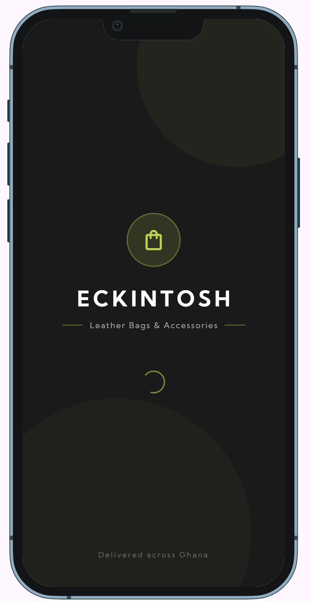
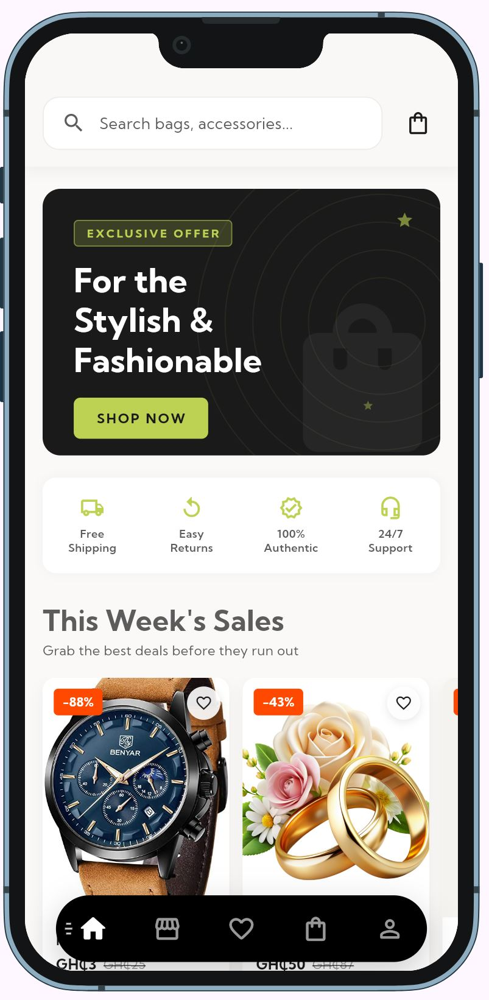
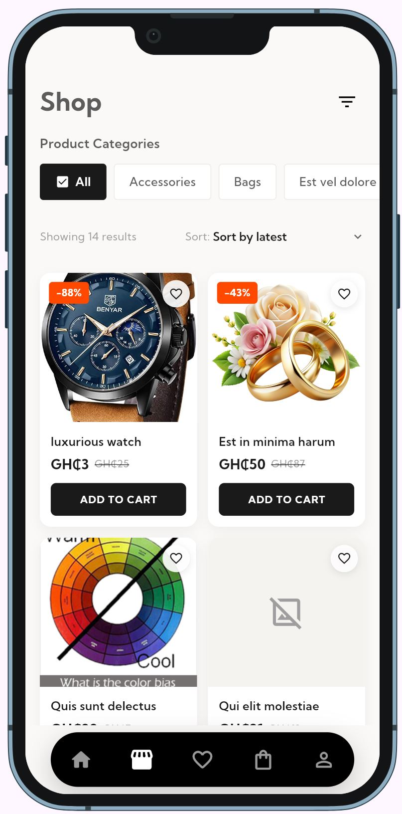
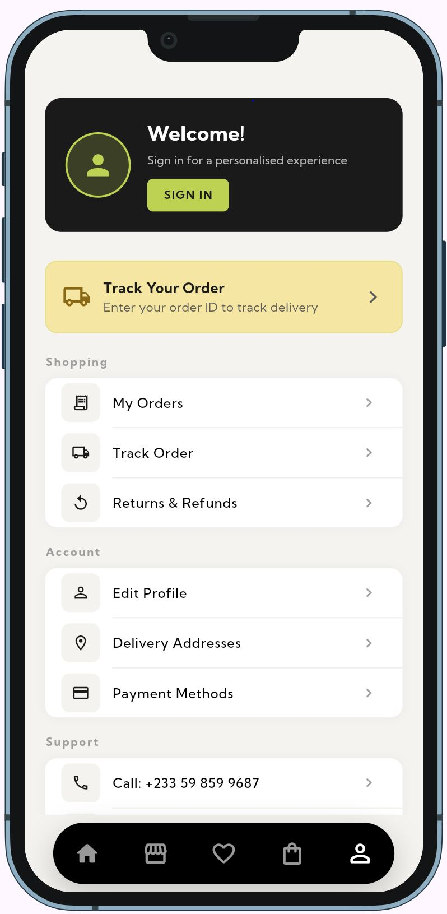

# GlobalCart GH - Shop Global, Pay Local

A full-stack Ghanaian e-commerce store. Customers can shop in the **Flutter mobile app** or on the **website** — both use the same Next.js backend, so the catalogue, account, wishlist, saved addresses, orders and returns are shared.

---

## What's in this repository

| Part | Where | What it does |
| --- | --- | --- |
| Mobile app | `lib/` (Flutter) | Android, iOS and web builds of the shopping app |
| Website | `backend/src/app/(store)` (Next.js) | The same shopping experience in the browser: home, shop with filters, product pages, cart, checkout, wishlist, order tracking, account, addresses, returns, help |
| Admin | `backend/src/app/admin` | Products (with image upload), orders, returns and dashboard — Google sign-in, restricted to `ADMIN_EMAILS` |
| API | `backend/src/app/api` | REST API used by the app, the website and the admin |

## Features

- **Shop anywhere**: the website mirrors the app; signing in with the same Google account syncs the wishlist, addresses, profile, orders and returns.
- **Catalogue**: categories, search, sort, price/colour/size filters, sale / new / best-seller collections, product pages with colour, size and quantity selection, sharing.
- **Cart**: per-variant lines, saved on the device, prices refreshed from the live catalogue, free-shipping progress.
- **Checkout**: Google sign-in, saved addresses, cash or Mobile Money on delivery, server-side pricing, protection against duplicate submissions and price changes.
- **After purchase**: confirmation and status emails, order timeline, public tracking by code (personal details hidden), cancel while pending, return requests within 14 days, buy again.
- **Admin**: dashboard, paginated order search, status updates with customer notes and emails, product management (products that appear in orders are archived, not deleted), return handling.

## Tech stack

- **App**: Flutter, BLoC, Firebase Auth (Google), shared_preferences
- **Backend & website**: Next.js 16 (App Router), React 19, Prisma, PostgreSQL (Neon), zod, Firebase Admin, Resend (email), Cloudinary (images)

---

## Screenshots

| Splash Screen | Home Page | Product Details | Profile |
| :---: | :---: | :---: | :---: |
|  |  |  |  |

---

## Setup

### Prerequisites

- Flutter SDK (stable)
- Node.js 20 or newer
- A PostgreSQL database (for example Neon)
- A Firebase project with **Google** enabled under Authentication → Sign-in method

### 1. Backend, website and admin

```bash
cd backend
npm install
cp .env.example .env        # then fill in the values (see below)

npm run db:push             # create / update tables
npm run db:seed             # optional: demo products
npm run db:backfill         # only for databases that already have orders (safe to re-run)

npm run dev                 # http://localhost:3000
```

Key settings in `backend/.env` (all are documented in `.env.example`):

| Variable | Needed for |
| --- | --- |
| `DATABASE_URL`, `DIRECT_URL` | Everything |
| `ADMIN_EMAILS` | Signing in to `/admin` (comma-separated Google emails) |
| `PUBLIC_APP_URL` | Absolute image URLs, email links, sitemap (set it in production) |
| `FIREBASE_ADMIN_PROJECT_ID` | Verifying sign-ins (defaults to this project) |
| `RESEND_API_KEY`, `ORDER_EMAIL_FROM` | Order emails (skipped when unset) |
| `CLOUDINARY_*` | Image uploads in the admin |
| `NEXT_PUBLIC_ANDROID_APP_URL`, `NEXT_PUBLIC_IOS_APP_URL` | "Get the app" links on the website |

For Google sign-in on the website, add your domain (for example `localhost` and your production domain) in Firebase Console → Authentication → Settings → Authorized domains.

### Deploying the website to Vercel

Set the Vercel project's **Root Directory** to `backend`, then add `DATABASE_URL`
in every Vercel environment you deploy. `DIRECT_URL` is recommended when your
database provider offers a separate direct connection, but the build safely
falls back to `DATABASE_URL` when it is absent. The production build runs an
idempotent `prisma db push` before Next.js prerenders database-backed pages, so
a new database receives the required tables automatically.

After the first successful deployment, load the starter catalogue once if the
store is empty:

```bash
cd backend
npm run db:seed
```

The seed is safe to rerun because products are upserted by id.

### 2. Flutter app

```bash
flutter pub get

# Emulator (talks to http://10.0.2.2:3000/api on Android)
flutter run

# Physical device or production
flutter run \
  --dart-define=API_BASE_URL=https://your-domain.com/api \
  --dart-define=WEB_BASE_URL=https://your-domain.com
```

**Google sign-in on Android** needs the app's SHA-1 fingerprint registered in Firebase (Project settings → Your apps → Android). Then download the new `google-services.json` into `android/app/`. If sign-in still returns no ID token, pass the project's *Web client ID* (Firebase → Authentication → Sign-in method → Google → Web SDK configuration):

```bash
flutter run --dart-define=GOOGLE_SERVER_CLIENT_ID=xxxx.apps.googleusercontent.com
```

---

## Testing

```bash
# Backend
cd backend
npm run typecheck
npm test
npm run build

# Flutter
flutter analyze
flutter test
```

---

## Security model

- All `/api/admin/*` routes and the `/admin` pages require a Google account listed in `ADMIN_EMAILS`.
- Customers only see their own orders, addresses, wishlist and returns (Firebase ID token required).
- Public order tracking needs the full 10-character code and hides phone, email and address.
- Prices, shipping and stock are always computed on the server; the client's expected total is checked so customers are never charged a different amount than they saw.
- Checkout requests carry an idempotency key so retries can't create duplicate orders.
- Rate limits on checkout, tracking, returns and uploads; uploads are verified by file contents.
- Security headers (frame, content-type, referrer, HSTS, permissions) on every response.

## Before publishing the Android app

1. **Application id** — replace the current `com.example` placeholder in `android/app/build.gradle.kts`, register the new id in Firebase and download its `google-services.json`. Google Play rejects `com.example` ids.
2. **Upload key** — create one once and keep it safe (losing it means you can't update the app):

   ```bash
   keytool -genkey -v -keystore ~/globalcart-upload.jks -keyalg RSA -keysize 2048 -validity 10000 -alias upload
   ```

   Then create `android/key.properties` (already gitignored):

   ```properties
   storePassword=<password from keytool>
   keyPassword=<password from keytool>
   keyAlias=upload
   storeFile=C:/Users/<you>/globalcart-upload.jks
   ```

   `flutter build appbundle` signs with this key automatically. Without the file, release builds fall back to the debug key, which works for testing but can't be uploaded to Google Play.
3. Add the upload key's SHA-1 (`keytool -list -v -keystore <file> -alias upload`) to Firebase too, or Google sign-in will fail in release builds.

## Roadmap

- [ ] Online payments (Paystack / Flutterwave)
- [ ] Push notifications for order updates
- [ ] Stock quantities per product and variant
- [ ] AI recommendations

## License

This project is licensed under the **MIT License**.
